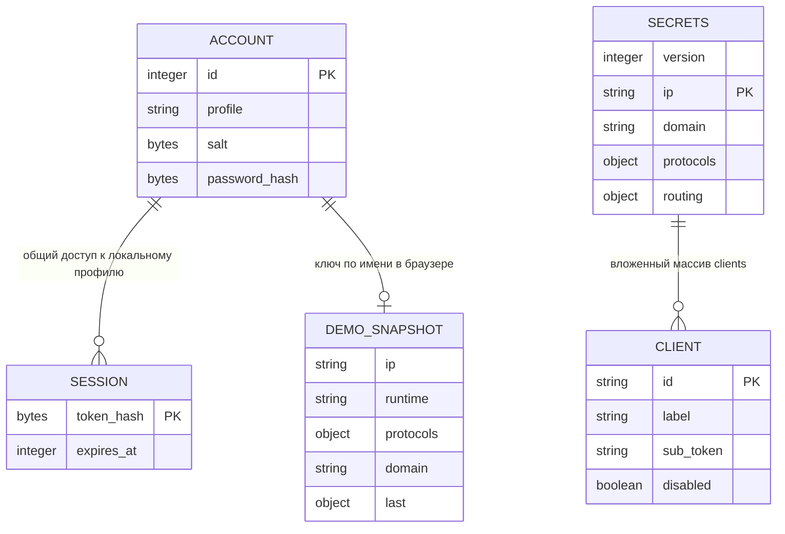
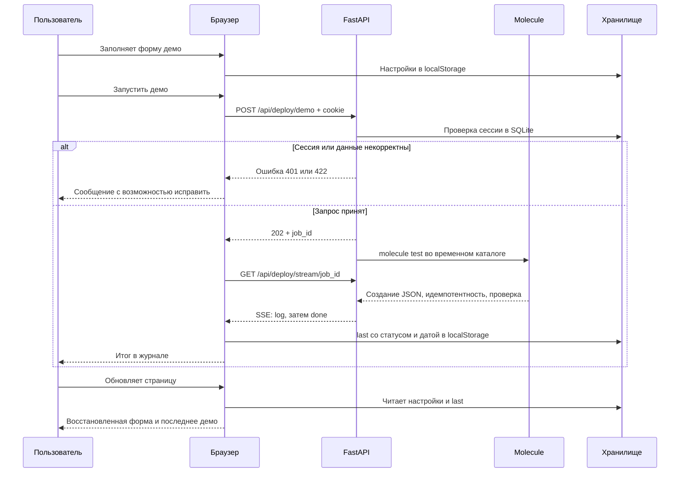

# Архитектура bypass

Фактическое устройство MVP на 21 ноября 2026 года. Приложение запускается локально одним процессом Uvicorn. Для учебного демо VPS и домен не требуются.

## Части приложения

| Часть | Реализация | Ответственность |
| --- | --- | --- |
| Веб-интерфейс | Jinja2, обычный JavaScript, Bootstrap 4.5.0 и собственный CSS | Вход, настройки, выбор режима, журнал, клиенты |
| HTTP-сервер | `vpnforge/main.py`, FastAPI | Проверка сессии, валидация запросов, управление заданиями, SSE |
| Локальный вход | `vpnforge/local_auth.py`, SQLite | Один профиль на каталог данных и сессии входа |
| Конфигурации | `vpnforge/models.py`, `secrets_store.py` | Проверенные Pydantic-модели в отдельных JSON-файлах по адресу VPS |
| Демо | `demo_deploy.py`, `ansible/demo/molecule/` | Изолированный локальный прогон Molecule: создание JSON, идемпотентность, проверка |
| Реальный деплой | `ansible_runner.py`, `ansible/deploy.yml` | Запуск Ansible по SSH на VPS |
| Автоматический TLS | `ansible/tasks/acme.yml`, Certbot, `ansible/files/bypass_cert_deploy.py` | Выпуск Let's Encrypt через HTTP-01, продление и обновление сертификатов служб на VPS |
| Генерация клиентских конфигов | `client_manager.py`, `config_builder.py`, `sub_builder.py` | Клиенты, подписки, Xray JSON и параметры протоколов |

Код пакета пока называется `vpnforge`; пользовательское название приложения - bypass. Node.js, сборка фронтенда, внешний сервер БД и облачный аккаунт для локального запуска не нужны. Зависимости устанавливаются из Poetry lock-файла; дополнительная группа `demo` содержит Molecule и Ansible.

## Модель данных и связи



На схеме показаны логические связи между разными хранилищами. В SQLite только таблицы `account` и `sessions`; внешнего ключа между ними нет, поскольку профиль единственный. `DEMO_SNAPSHOT` - объект localStorage, а `SECRETS` и `CLIENT` - JSON-документ и его вложенные записи. Локальный профиль даёт доступ ко всем конфигурациям в каталоге данных; отдельного владельца VPS в модели нет.

### Профиль и сессии: SQLite

Файл: `<VPNFORGE_DATA_DIR>/auth/auth.sqlite3`, по умолчанию `data/auth/auth.sqlite3`.

| Таблица | Поля | Правила |
| --- | --- | --- |
| `account` | `id INTEGER PRIMARY KEY CHECK(id = 1)`, `profile TEXT`, `salt BLOB`, `password_hash BLOB` | Единственная запись. Имя 2–40 печатных символов; пароль 8–128 символов. Вход сравнивает имя без учёта регистра |
| `sessions` | `token_hash BLOB PRIMARY KEY`, `expires_at INTEGER` | SHA-256 от случайного токена и время истечения Unix в секундах. Сессии относятся к единственному профилю |

Пароль хранится как scrypt-хеш с индивидуальной случайной солью: `n=2**17`, `r=8`, `p=1`. Восстановить исходный пароль из записи приложение не умеет. Cookie `bypass_session` содержит случайный токен, имеет `HttpOnly`, `SameSite=Strict`, срок семь дней и `Secure` при HTTPS. В SQLite записан только хеш токена. Выход удаляет сессию, вход очищает истёкшие сессии. Профиль и действующие сессии переживают перезапуск сервера. SQLite-файл имеет права `0600`, каталог - `0700`.

### Последнее демо: localStorage

Ключ: `bypass-demo:<имя профиля в нижнем регистре>`. Сохраняются только перечисленные поля:

| Поле | Тип | Содержание |
| --- | --- | --- |
| `ip` | string | Адрес из формы |
| `runtime` | `native` или `docker` | Выбранное окружение; в демо сохраняется как параметр описания |
| `protocols` | object из boolean | `hysteria2`, `vless_reality`, `openflux` |
| `domain` | string | Полное имя поддомена, например `vpn.example.com` |
| `last` | object или null | `ip: string`, `status: success/failed/cancelled/interrupted`, `finishedAt: ISO date string`. `interrupted` означает неизвестный итог при окончательно недоступном журнале |

Пример учебной записи, не содержащий секретов:

```json
{
  "ip": "203.0.113.10",
  "runtime": "native",
  "protocols": {"hysteria2": true, "vless_reality": false, "openflux": false},
  "domain": "vpn.example.test",
  "last": {
    "ip": "203.0.113.10",
    "status": "success",
    "finishedAt": "2026-11-21T10:00:00.000Z"
  }
}
```

Форма записывается при изменениях и заполнении примера, результат - после получения итогового события. Запись доступна в том же браузере по тому же origin (схема, имя хоста и порт). `localhost:8000` и `127.0.0.1:8000` имеют разные localStorage. Обновление страницы и перезапуск backend сохраняют запись; очистка данных сайта её удаляет. Полный журнал и SSH-пароль в эту запись не попадают.

При загрузке старых записей `sub` и `root` объединяются в `domain`. Такой же перенос
выполняется для DNS-настроек реального режима. При следующем сохранении записывается
только полное имя. Для Cloudflare зона определяется поиском среди родительских имён,
без предположения, что корневой домен всегда состоит из двух частей.

### Настройки реального режима: localStorage

Ключ `vpnforge-state` содержит группы `protocols`, `vps`, `dns`, `certs`, `openflux`, `routing`. Перед записью очищаются `vps.password`, `dns.cfToken` и `openflux.encKey`; эти поля также не восстанавливаются из старых записей. При чтении загружаются только известные поля совместимых типов; значения переключателей проверяются по допустимому списку. Повреждённые записи VPS и демо обрабатываются независимо. Это общий ключ браузера, без разграничения по имени профиля. Он не является резервной копией серверных секретов.

### Конфигурация VPS и клиенты: JSON

Файл: `<VPNFORGE_DATA_DIR>/secrets/<ip-or-host>.json`. Корневая модель `Secrets`:

| Поля | Тип и назначение |
| --- | --- |
| `version`, `ip`, `domain` | int; string-ключ VPS; string или null |
| `created_at`, `updated_at` | Даты создания и обновления UTC |
| `protocols` | Три boolean-флага включённых протоколов |
| `reality` | null или объект: `private_key`, `public_key`, `short_id`, `dest`, `server_name`, `fingerprint`, `spider_x`, `xhttp_path`, `xhttp_mode` |
| `hysteria2` | null или объект: `obfs_password`, `masquerade_url` |
| `openflux` | `transport`, `mode`, `codec`, `local_ip`, `yandex_url`, `max_token`, `max_uid`, `encryption_key`, `session_b64`, `debug`; необязательные строки могут быть null |
| `routing` | `ru_direct`, `private_direct`: boolean; `custom_direct_domains`: string[] |
| `cloudflare` | `zone_id`, `record_id`: string или null |
| `cert` | `not_after`: дата или null; `issuer`, `sha256`: string или null |
| `clients` | Массив Client, от нуля до нескольких записей на VPS |

Каждый `Client` содержит `id`, `label`, `created_at`, `sub_token`, `vless_uuid`, `hysteria_user`, `hysteria_pass`, `disabled`. Клиент принадлежит одному документу VPS; `sub_token` используется для доступа к подписке и конфигу. Пароли протоколов и ключи в JSON хранятся открыто с ограничением файлового доступа, а не шифруются паролем локального профиля.

Запись атомарная: временный файл, `fsync`, `os.replace`; права файла `0600`, каталога по возможности `0700`. Импорт валидируется Pydantic, адрес документа должен совпадать с запрошенным. Архивные копии хранилища размещаются в `_archive/`. Автоматической синхронизации между устройствами нет.

### Задание запуска: память процесса

`AppContext.jobs` сопоставляет `job_id` с `DeployJob`. В задании находятся `job_id`, `status`, `history` (события `id/event/data`), `error`, сигнал `done`, очереди подписчиков и задача `demo_task` для демо. Статусы: `pending`, `running`, `success`, `failed`, `cancelled`. SSE отдаёт накопленные события, затем новые строки и единственное событие `done`. При переподключении `Last-Event-ID` задаёт номер последнего полученного события; сервер передаёт следующие события без повторов. Очередь подписчика удаляется при закрытии потока. Временный обрыв связи не завершает задачу в интерфейсе; закрытие недоступного потока сохраняет отдельный клиентский результат `interrupted`, не меняя серверный статус задания.

После перезапуска backend задания и журналы исчезают. Последний результат демо в браузере остаётся отдельной краткой записью. Для реального деплоя служебный каталог `data/runs/<job_id>/` содержит inventory и group vars и удаляется в `finally`. Демо создаёт отдельный временный каталог с JSON и сценарием Molecule и также удаляет его после завершения.

## Поток от кнопки до сохранённого результата



Для реального режима используется `POST /api/deploy`: backend валидирует запрос, подготавливает и сохраняет Secrets, создаёт клиента по умолчанию при необходимости, запускает Ansible по SSH и передаёт вывод через тот же SSE API. Успешный HTTP-ответ `202` означает принятие задания, а не успешную настройку сервера. Изменение локального JSON до завершения Ansible также не доказывает успешный деплой.

### Автоматический TLS на VPS

`DeployRequest.certificate_source` принимает `upload`, `vps` или `letsencrypt`.
API сохраняет прежний default `upload` для совместимости; новая форма по умолчанию
выбирает `letsencrypt`. Автоматический режим проверяет DNS-имя до создания задания,
нормализует его в ASCII/IDNA и не принимает IP, URL, wildcard и небезопасные имена.
Параметры попадают в inventory, включая `hysteria2.acme_domain`.

Ansible устанавливает Certbot, проверяет DNS и свободный порт 80, при активном UFW
разрешает входящий HTTP и запрашивает сертификат с именем `bypass-<домен>`.
Certbot хранит ключи и параметры продления в `/etc/letsencrypt/`; их не передают обратно
в локальную SQLite или JSON. При автоматическом режиме локальный `Secrets.cert`
не содержит метаданных сертификата с VPS.

После успешного выпуска `/etc/vpnforge/acme.json` хранит активные `domain` и `runtime`.
Deploy hook сверяет `RENEWED_LINEAGE` с этим доменом, атомарно заменяет каждый файл
в `/etc/vpnforge/certs/` и перезапускает активных потребителей сертификата: native
systemd-службы или Docker-контейнеры Hysteria и подписок. Файл
`/etc/vpnforge/acme-deployed.sha256` отмечает успешно применённую версию; при ошибке
перезапуска повторный запуск hook повторяет попытку. Продление выполняет
`certbot.timer`, независимо от работы локальной панели.

При выборе ручного TLS или отключении Hysteria Ansible удаляет `acme.json`:
hook больше не меняет сертификаты bypass. При смене домена hook игнорирует старую
линию сертификата. Старые линии Certbot и их настройки продления автоматически
не удаляются. Внешний firewall провайдера и DNS без Cloudflare token пользователь
настраивает самостоятельно. В деморежиме этот механизм не запускается.

## Ограничения MVP

- Демо проверяет учебное JSON-описание и идемпотентность сценария; VPN-службы, соединение клиента и доступность VPS оно не проверяет. Значение `docker` в демо не запускает Docker.
- Нет многопользовательских ролей, восстановления пароля, внешней БД или серверной истории заданий. Смена пароля через интерфейс пока не предусмотрена.
- Рассчитано на один процесс сервера. Несколько Uvicorn workers не разделяют задания и SSE-журналы.
- Отмена демо останавливает задачу и локальную группу процессов. Отмена реального запуска пока только меняет статус и не гарантирует остановку Ansible на VPS.
- JSON-хранилище не содержит блокировок для конкурентного изменения одного VPS. История заданий в памяти не ограничена по размеру и живёт до остановки процесса.
- Бэкап каталога данных и очистку браузера пользователь контролирует самостоятельно. Файлы `data/` не входят в материалы сдачи.

## Изменения модели в дальнейшем

При добавлении поля в JSON следует задать совместимое значение по умолчанию и проверить загрузку старого документа. `Secrets.version` уже существует, но общего механизма миграций нет. Для SQLite нужны явные миграции до изменения обязательных колонок; `CREATE TABLE IF NOT EXISTS` не обновляет структуру существующей таблицы. Для localStorage потребуется версия записи и преобразование старых данных, если изменятся имена или смысл полей. Эти механизмы развития пока не реализованы.
