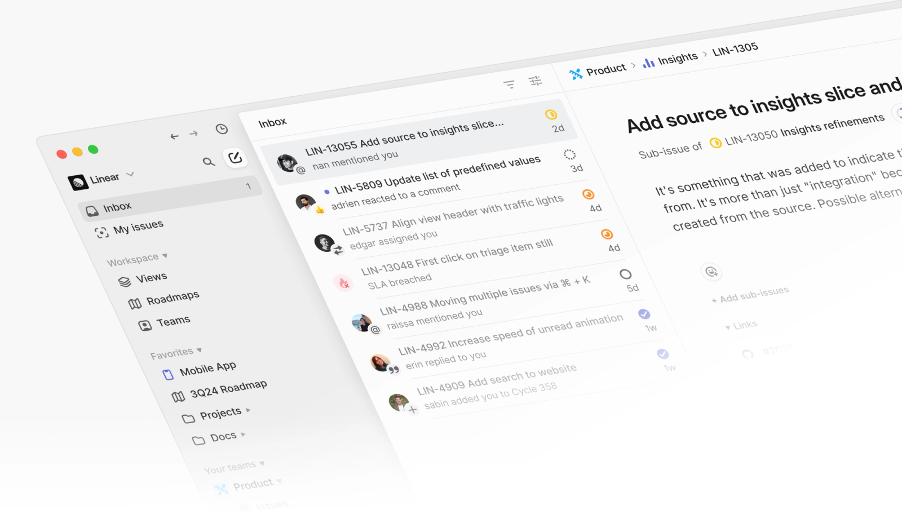
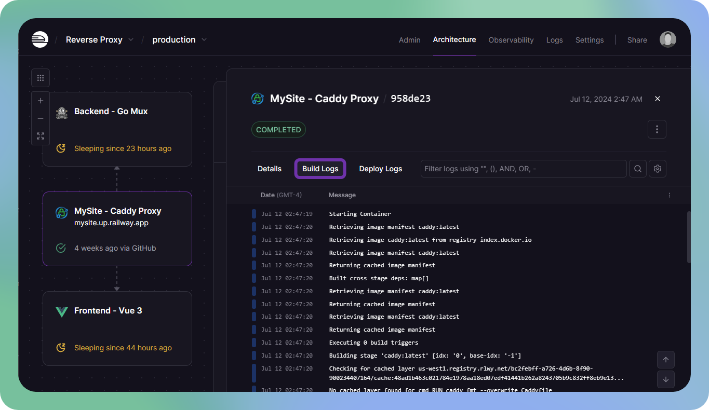
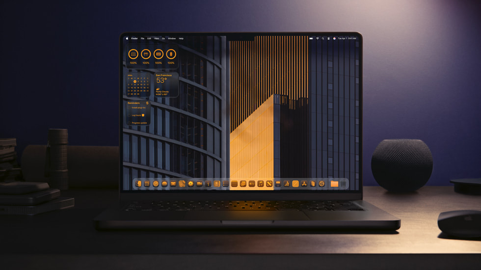

# Референсы интерфейса bypass

Подборка от 21 ноября 2026 года. Изображения сохранены локально, чтобы приложить их к сдаче вместе с DESIGN.md. Это опубликованные авторами изображения реальных продуктов. Цвета bypass и знак с маршрутом описаны в [DESIGN.md](../../../DESIGN.md).

Подборка уточняет уже существующий интерфейс. Railway был указан в DESIGN.md раньше; остальные источники выбраны на этапе финальной проверки MVP. Ниже отдельно отмечены совпадающие решения и ориентиры для дальнейшей работы.

## 1. Linear: компоновка и иерархия

- [Первоисточник: How we redesigned the Linear UI, part II](https://linear.app/now/how-we-redesigned-the-linear-ui).
- [Оригинал изображения](https://webassets.linear.app/images/ornj730p/production/900ab5bbf41d4245dcd32122b80ed523c5a00e2f-2352x1344.png).
- Выбрано: разделение рабочих областей, выравнивание элементов, неброские границы и вторичный текст.
- Для bypass: настройки слева, результат справа, единые оси подписей, полей и заголовков. Сайдбар трекера задач нам не нужен. Светлая палитра Linear на этом изображении не задаёт тему bypass.
- Уже есть: две рабочие области и разделители секций. Следующая визуальная проверка должна сверить интервалы между повторяющимися полями и заголовками на широком и узком экранах.

## 2. Railway: журнал запуска

- [Первоисточник: Railway Logs](https://docs.railway.com/observability/logs).
- [Оригинал изображения Build Logs](https://res.cloudinary.com/railway/image/upload/v1722993947/docs/build_logs_og7uec.png).
- Выбрано: самостоятельная область вывода, название запуска над журналом, видимый итог и моноширинный текст.
- Для bypass: журнал Ansible или Molecule рядом с формой, понятные состояния ожидания, выполнения, ошибки и завершения. Демо явно обозначается как симуляция.
- Уже есть: отдельная панель журнала, поток строк и статусы. Карта сервисов, поиск по логам и вкладки со скриншота не входят в текущий MVP.

## 3. Apple: материал Liquid Glass

- [Первоисточник: Apple introduces a delightful and elegant new software design](https://www.apple.com/newsroom/2025/06/apple-introduces-a-delightful-and-elegant-new-software-design/).
- [Оригинал изображения](https://www.apple.com/newsroom/images/2025/06/apple-introduces-a-delightful-and-elegant-new-software-design/article/Apple-WWDC25-Liquid-Glass-Home-Screen-dark-tint-250609_big.jpg.large.jpg).
- Выбрано: полупрозрачный материал элементов управления на тёмном фоне. Это ориентир поверхности, а не компоновки веб-приложения.
- Для bypass: ограниченное применение стекла у шапки, формы входа и внешней поверхности журнала. Под самим выводом сохраняется тёмный читаемый фон.
- Уже есть: CSS-размытие, прозрачность, границы и тени. Реализация bypass стилизует материал средствами CSS; динамического преломления Apple в ней нет.

## 4. Proton Account: форма входа с паролем

- [Первоисточник: Troubleshooting sign-in issues](https://proton.me/support/common-login-problems), раздел Check your password.
- [Оригинал изображения](https://res.cloudinary.com/dbulfrlrz/images/w_1024,h_313,c_scale/f_auto,q_auto/v1774419631/wp-pme/image-54_914975038c/image-54_914975038c.png?_i=AA).
- Выбрано: явные подписи над полями, порядок «имя → пароль → вход», заметная основная кнопка. Красная рамка на изображении является пояснением из справки Proton.
- Для bypass: справа размещается форма локального профиля; слева остаются заголовок и авторская схема маршрута. При создании профиля есть повтор пароля.
- Уже есть: подписанные поля и основная кнопка. Переключатель видимости пароля из Proton пока не реализован. Восстановление через почту и облачная учётная запись не относятся к выбранному локальному сценарию.

## Как использовать при проверке

1. Открыть вход и панель bypass рядом с изображениями.
2. Сверить компоновку с Linear, журнал с Railway, форму с Proton, поверхности с Apple.
3. Проверить читаемость подписей, статусов и фокуса, а также интервалы между повторяющимися полями.
4. На узком экране проверить порядок формы и журнала и отсутствие горизонтального переполнения.
5. После изменений обновить DESIGN.md и записать, какие решения действительно применены.

Изображения принадлежат Linear, Railway, Apple и Proton и приведены с указанием первоисточников для учебного разбора дизайна. Они не включаются в интерфейс приложения; лицензии Bootstrap и Tabler не распространяются на эти материалы.
